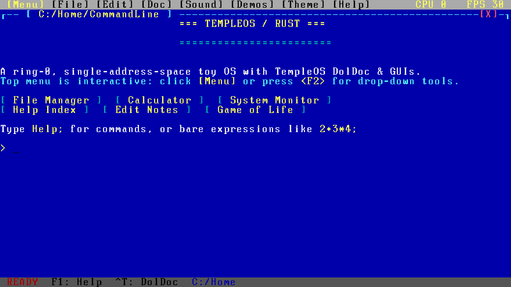

# TempleOS/Rust

A tiny TempleOS-inspired operating system prototype written in Rust. It boots
from a hand-written BIOS bootloader into 64-bit long mode and drops you into an
authentic TempleOS-style environment: DolDoc hypertext, HolyC command line,
PC speaker audio, RedSea virtual filesystem, and an interactive text editor.



No libc. No allocator. No preemptive scheduler. No processes. No permissions.
No networking. Ring 0, single address space — just a screen, a keyboard, sound,
and a HolyC REPL.

## Build

Requires a Rust toolchain (the host target is fine), `gcc` for the 16-bit
bootloader, `ld.lld`, `objcopy`, and `dd`.

```sh
./build.sh
```

This produces `build/templeos.img`, a raw legacy-BIOS disk image.

## Run

### QEMU

```sh
qemu-system-x86_64 -m 64 -drive format=raw,file=build/templeos.img -audiodev pa,id=snd0 -machine pcspk-audiodev=snd0
```

*(The `-audiodev` and `-machine pcspk-audiodev` flags enable the PC speaker sound under QEMU).*

### GNOME Boxes

```sh
gnome-boxes build/templeos.img
```

## TempleOS Features

### 1. DolDoc Hypertext Markup Engine
All text output is rendered through a DolDoc engine supporting dollar-sign commands:
- `$FG,col$` and `$BG,col$`: text and background colors (0–15 or standard color names)
- `$TX+CX,"..."$` and `$TX+RD,"..."$`: center- and right-aligned text
- `$IV,1$` / `$IV,0$`: inverted video
- `$MA,"label",LM="cmd"$`: macro buttons
- `$$`: literal dollar sign
- `<CTRL-T>`: toggles between formatted view and raw DolDoc source text in real time.

### 2. HolyC Command Line Syntax
Commands follow HolyC function call conventions:
- Trailing semicolons are standard (e.g. `Dir;`, `Cd("C:/Doc");`, `Beep;`).
- Zero-argument functions can omit parentheses (`Dir;`, `Cls;`, `Help;`).
- Forgiving parser also supports standard command line input without semicolons.

### 3. PC Speaker Audio Subsystem
- `Beep;` / `Beep(freq, ms);`: emits standard TempleOS tones.
- `Snd(freq);` / `Snd;`: generates square-wave audio via PIT Channel 2 (`Snd;` silences).
- `Play("score");`: TempleOS music macro player supporting octaves (`O1`–`O7`), note lengths (`L1`–`L16`), notes (`A`–`G`), accidentals (`#`, `+`, `-`), dotted notes, and relative octave shifts (`>`, `<`).

### 4. RedSea Virtual Filesystem
Hierarchical in-memory virtual filesystem structured as `C:/`:
- `C:/Home/`: user workspace and scratchpad (`Notes.DD`).
- `C:/Doc/`: technical charters and documentation (`Charter.DD`, `DolDoc.DD`, `HolyC.DD`, `Help.DD`).
- `C:/Apps/`: applications and code headers (`Snake.HC`, `Life.HC`).
- `C:/Demo/`: audio and demo scripts (`Speaker.HC`).

### 5. Interactive DolDoc Editor (`Ed`)
Launch with `Ed("filename");` to edit files in full-screen:
- Arrow keys, Home, End navigation.
- Typing, Enter, Backspace editing.
- `<ESC>` saves changes to the VFS and exits; `<CTRL-Q>` aborts.

### 6. Authentic Visual Chrome & Themes
- Top Menu Bar: gold/brown status strip with menu indicators and CPU/FPS counters.
- Window Frame: CP437 box-drawing border with `[X]` close widget.
- 16-color VGA palette with full 256-glyph CP437 font.
- Themes: switch dynamically with `Theme("classic");` (TempleOS white canvas), `Theme("blue");`, or `Theme("dark");`.

## Commands

| Command | Description |
| --- | --- |
| `FileMgr;` / `FM;` | dual-pane graphical file manager with mouse support |
| `CalcGui;` / `Calc;` | interactive desktop calculator window |
| `SysMon;` | system monitor dashboard and hardware meters |
| `Dir;` / `Dir("path");` | list directory contents with color-coded DolDoc links |
| `Cd;` / `Cd("path");` | change working directory |
| `Pwd;` | print current directory |
| `Type("file");` / `Cat("file");` | render text or DolDoc file |
| `Ed("file");` | open interactive DolDoc text editor |
| `Del("file");` | delete a file |
| `MkDir("path");` | create a directory |
| `Beep;` | play system beep |
| `Snd(freq);` / `Snd;` | set PC speaker frequency (`Snd;` to stop) |
| `Play("notes");` | play music macro score on PC speaker |
| `MemRep;` / `Mem;` | display memory report and boot tables |
| `CpuRep;` / `Cpu;` | display CPU registers, TSC, and long-mode state |
| `Date;` / `Time;` | display system uptime and TSC timestamp |
| `Who;` | task status report |
| `Theme("name");` | switch theme (`"classic"`, `"blue"`, `"dark"`) |
| `DocToggle;` | toggle raw DolDoc display (`<CTRL-T>`) |
| `Cls;` / `Clear;` | clear the screen |
| `Help;` / `Man;` | master command and documentation index (`<F1>`) |
| `About;` / `Ver;` | system information |
| `Bench;` / `FPS;` | measure fill and text-repaint speed |
| `Snake;` | play snake arcade game |
| `Life;` | Conway's Game of Life simulation |
| `Lines;` / `Graphics;` | 16-color geometric line demo |
| `Reboot;` | reboot the machine |
| `Halt;` | stop the CPU |

Bare integer expressions are evaluated directly (e.g. `(2+3)*4;`).

## Hotkeys

| Hotkey | Action |
| --- | --- |
| `<F1>` | Open master help and documentation |
| `<CTRL-T>` | Toggle between formatted DolDoc and raw markup |
| `<CTRL-L>` | Clear screen |
| `<CTRL-C>` | Cancel current input line |

## Layout

| Path | What it does |
| --- | --- |
| `boot/boot.S` | 512-byte MBR; loads stage 2 with INT 13h LBA reads |
| `boot/stage2.S` | A20, VBE mode selection, kernel load, 4 GiB page tables, long mode |
| `src/main.rs` | entry point, `BootInfo`, freestanding `mem*` and `bcmp` |
| `src/fb.rs` | linear framebuffer + planar fallback, scaled 8×16 glyphs |
| `src/vga.rs` | planar VGA mode 12h fallback driver |
| `src/term.rs` | 80×30 terminal with TempleOS menu bar, CP437 frames, and themes |
| `src/doldoc.rs` | DolDoc hypertext markup parser and renderer |
| `src/sound.rs` | PC speaker sound driver and music macro interpreter |
| `src/vfs.rs` | contiguous RedSea-style virtual filesystem and docs |
| `src/editor.rs` | full-screen DolDoc text editor (`Ed`) |
| `src/keyboard.rs` | polled PS/2 keyboard driver with Ctrl, Alt, and F-keys |
| `src/shell.rs` | HolyC REPL, command dispatcher, and mini-games |
| `src/expr.rs` | recursive-descent integer evaluator |
| `src/font.rs` | complete 256-glyph CP437 VGA font |
| `tools/mkfont.py` | extracts 256 glyphs from `alt-8x16` console font |
